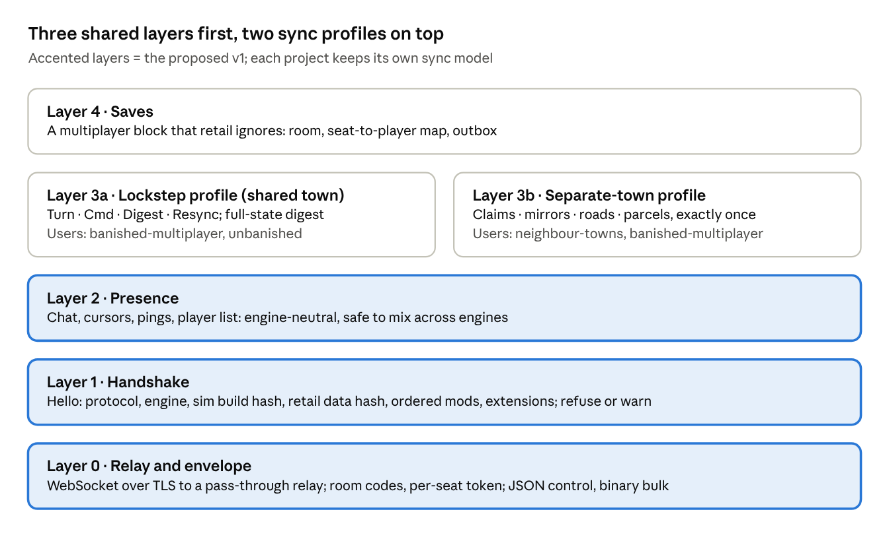

# Banished Multiplayer: Comparison and a Common Standard

As of 2026-10-21 · proposal, open for discussion

## Summary

Three open Banished multiplayer projects exist, and they make two different choices. banished-multiplayer and unbanished run deterministic lockstep: every player simulates the same shared town and only commands travel. OpenBA neighbour-towns gives each player a separate town on a shared map and exchanges events through a relay, with no lockstep.

The three also run on three different engines: a hook into the retail exe, a Rust reimplementation and a C++ reimplementation. Lockstep only works between bit-identical simulations, so a lockstep game across engines is not a realistic first goal. The relay, the handshake, presence and the separate-town event layer can be shared now. The proposal below is therefore layered, so each project adopts the layers that fit its engine without giving up its sync model.

## At a glance

|  | [banished-multiplayer](https://github.com/BarryBareth/banished-multiplayer) | [unbanished](https://github.com/tanepiper/unbanished) | [OpenBA neighbour-towns](https://github.com/dreadylocks/OpenBA/tree/neighbour-towns) |
| --- | --- | --- | --- |
| Built on | Retail 1.0.7 x64, hooked through a `dinput8.dll` proxy (MinHook) + a `.pkm` data mod | Rust reimplementation (wgpu, WebAssembly build), aims for 1:1 with retail | C++ reimplementation fork, as the off-by-default extension `ext.neighbour` |
| Licence | MIT | MIT OR Apache-2.0 | Fork of OpenBA |
| Version | 0.9.4 | 0.4.0 beta (multiplayer since 0.3.0) | Milestones M0 to M3 built |
| Game model | Shared town, or separate towns on one map (trade, shared storage, lent workplaces) | Shared town only; separate towns planned | Separate towns on one shared map; land, buildings, roads and trees mirrored; citizens, fire, disease and weather not shared |
| Players | Up to 8 by Steam lobby; no cap found over TCP | No cap found; tested with 3 over the network | Exactly 2 |
| Sync | Lockstep, 60 Hz, 150 ms input delay, `TURN` messages | Lockstep, 60 Hz, 6-tick (100 ms) delay, `Turn` messages | Event exchange; same seed = same land; trees on their own RNG |
| Desync check | Every 600 ticks: hash of the random-draw chain + sim-heap layout | Every 600 ticks: CRC-32 of the encoded save minus camera and UI | Land height hash only; a mismatch warns |
| Recovery | Automatic resync: host save sent as base64 in 45 KB chunks | Automatic resync with the host save + rewind of players ahead or behind | None; the planned repair snapshot is not built |
| Join mid-game | Yes, through resync; reconnect token | No | Yes: the relay replays stored claims, buildings and roads |
| Speed and pause | Shared (`CTL`) | Shared commands; the pause menu does not pause | Not linked (planned as M4) |
| Transport | Steam lobby, a TCP relay with room codes, or direct TCP (port forward) | WebSocket relay that passes data through unread; room codes | WebSocket over TLS to a Cloudflare relay; lobby list |
| Wire format | Newline-terminated text lines | postcard (binary) | Flat JSON, 16 KB per message |
| Version check | Build id = version + hash of the DLL code; refused with `BADVERSION` | None (designed, not built) | Protocol version only |
| Auth and encryption | None (Steam traffic goes through Valve's relays) | None, plain `ws://` | Shared room password + TLS; a seat is matched by town name |
| Mod check | None | None | None |
| Platforms | Windows; Steam and GOG players together | Windows, macOS, Linux, browser; browser and native players together | Windows only |
| Tests | ~70 UI scripts, multi-instance harness, desync diff tools | Lockstep tests with injected jitter and corruption; record and replay | 13 unit tests, 40 relay checks; one PC against a stand-in script, no two-player game yet |

## Pros and cons

### banished-multiplayer

Strengths:

- Runs today on the retail game players already own; Steam and GOG players share a session.
- The widest feature set: both game models, join mid-game, cursors and Alt+click pings, trading between separate towns.
- Serious determinism work: a deterministic sim heap, call-site random seeds, synchronous pathfinding, a ring-buffer event log with `ringdiff.py` to find the first divergence.

Weaknesses:

- Tied to one exe build through hard-coded addresses; a game patch breaks it.
- The desync hash covers the random-draw chain, so a state difference goes unseen until it changes a draw.
- Window commands name their target by deterministic-heap offset, which no other engine can reproduce.
- No encryption or authentication; the host is a single point of failure with no migration.

### unbanished

Strengths:

- The cleanest separation: a headless `crates/sim` core, a typed `PlayerCommand` list, and every multiplayer divergence marked `Deviation:`.
- The digest covers the whole saved state, not only the random draws.
- Runs on every desktop platform and in the browser.
- Record and replay doubles as a determinism test and a bug-report format.

Weaknesses:

- No version, data or mod handshake: a mismatch shows up only as repeated resyncs.
- No join mid-game or rejoin; nobody compares digests once the host leaves.
- No authentication or TLS, and no public relay.
- Cross-platform determinism is proven only for arm64 and Chromium.

### OpenBA neighbour-towns

Strengths:

- Needs no determinism: a slow link never stalls either town.
- Parcels (goods, families) are delivered exactly once, even to a player who is offline.
- The relay is the one referee for land claims, so a tile is never granted twice.
- Off by default behind OpenBA's extension seams; the faithful game is untouched.
- The only wire format of the three that could realistically work between different engines.

Weaknesses:

- Two players, Windows only.
- The default relay address is hard-coded to one Cloudflare account.
- Drift is possible: a tree felled by both towns, saplings growing apart, pathfinding unaware of the neighbour's buildings.
- Seats are matched by town name behind one shared password, and no two-player game has been played yet.

## Proposed common standard

The proposal is five layers. Layers 0 to 2 are engine-neutral and form the proposed v1; the two sync profiles in layer 3 sit on top, and a project implements only the profile it uses.

Every project gets the bottom three layers; the lockstep and separate-town profiles stay independent of each other.

### Layer 0: relay and envelope

- WebSocket over TLS (`wss://`) to a relay that forwards data unread. This passes NAT and works in the browser. Steam and direct TCP stay allowed as carriers under the same messages.
- Rooms: a code, an optional password, and a per-seat secret token issued on first join. A seat is never matched by name.
- Envelope: a JSON object with a type field for control messages; binary frames for bulk data (turns, saves).
- One reference relay that anyone can self-host, with no default address tied to one person's account.

### Layer 1: handshake

- `Hello` carries: protocol version, engine id and version, sim build hash, retail data hash, ordered mod list with hashes, active extension set.
- The spec names, per field, whether a mismatch refuses the join or only warns. A starting point: protocol version always refuses; sim build hash and mod list refuse in lockstep and warn in the separate-town profile; retail data hash refuses in both, since both need the same land.

### Layer 2: presence

- Chat, cursor position in world coordinates, ping markers, the player list, join and leave notices.
- Nothing here touches the simulation, so players on different engines can mix freely.

### Layer 3a: lockstep profile (shared town)

- Fixed 60 Hz step; input delay set in milliseconds and converted to ticks.
- `Turn(player, tick)` promises all of a player's commands up to that tick; `Cmd(player, seq, tick, command)` carries one command.
- `Digest` every N ticks hashes the full simulation state, not only the random draws.
- `Resync` sends the host save in binary chunks with a hash. Joining mid-game reuses the resync path.
- Speed and pause are shared commands.
- A common command list: place, drag (road, fence, remove, zone), workers, limits, crops, recipes, upgrades, nomads, merchant trade, rename, speed, pause.
- Commands name their target by a stable entity or building id, never by a memory offset.
- A shared replay format: JSON lines, one command per tick.
- Lockstep works only between identical simulation builds at first. The shared spec still lets one relay, one replay tool and one desync differ serve every project.

### Layer 3b: separate-town profile

- Land claims refereed by the relay.
- Building mirrors (template, position, rotation), roads and natural-resource changes.
- Parcels (goods, families) delivered exactly once: outbox, relay store, receiver ack, duplicate filter.
- Two additions to the current neighbour-towns design: a periodic snapshot to repair drift, and a harvest lease so two towns cannot fell the same tree.
- This profile can work across engines. Agreed goods and family messages would let a retail-hook player trade with an OpenBA player.

### Layer 4: saves

- A multiplayer block that retail skips: room, seat-to-player map, outbox, last ids seen.
- banished-multiplayer and neighbour-towns already keep their own versions of this block.
- A candidate carrier: the [save tail v2](../saves/save-tail-v2.md) chunk inside block 1, which retail ignores.

## Path to agreement

Agreement is easiest in three steps, cheapest first:

1. Layers 0 to 2 as v1. No project gives up its sync model, and all three get a shared relay, a handshake and chat.
2. Layer 3b between banished-multiplayer and neighbour-towns, the two projects that already run separate towns.
3. The layer 3a command list and replay format between banished-multiplayer and unbanished, the two lockstep projects.

## Open questions for maintainers

- [ ] Wire encoding: JSON for control and binary for bulk, or one format (JSON, CBOR, postcard) throughout?
- [ ] Who hosts the reference relay, and under whose account? Cloudflare Worker, a small native server, or both?
- [ ] Which handshake mismatches refuse and which only warn, per profile?
- [ ] Stable entity ids: can the retail hook derive them, or does it need a translation table in the save?
- [ ] Player cap: 2 for the separate-town profile at first, or N from the start?
- [x] Where the spec lives: this repository, with the maintainers of all three projects as collaborators.

## Sources

Source code and docs of each repository were read at the commits below; none of the three was built or run.

- [BarryBareth/banished-multiplayer](https://github.com/BarryBareth/banished-multiplayer), commit `dc55b0f` (2026-10-19, version 0.9.4): `src/net.cpp`, `src/hooks.cpp`, `src/commands.cpp`, `docs/HOW_IT_WORKS.md`, `docs/RELAY.md`
- [tanepiper/unbanished](https://github.com/tanepiper/unbanished), commit `3dcbfff` (2026-10-21, version 0.4.0): `apps/game/src/gameplay/lockstep.rs`, `crates/net`, `crates/sim/src/command.rs`, `docs/MULTIPLAYER-PLAN.md`, `docs/guide/MULTIPLAYER.md`
- [dreadylocks/OpenBA, branch neighbour-towns](https://github.com/dreadylocks/OpenBA/tree/neighbour-towns), commit `69fc77c` (2026-10-20): `docs/fork/NEIGHBOUR_TOWNS.md`, `src/ext/neighbour/`, `tools/neighbour_server/`

Corrections are welcome as issues or pull requests.
